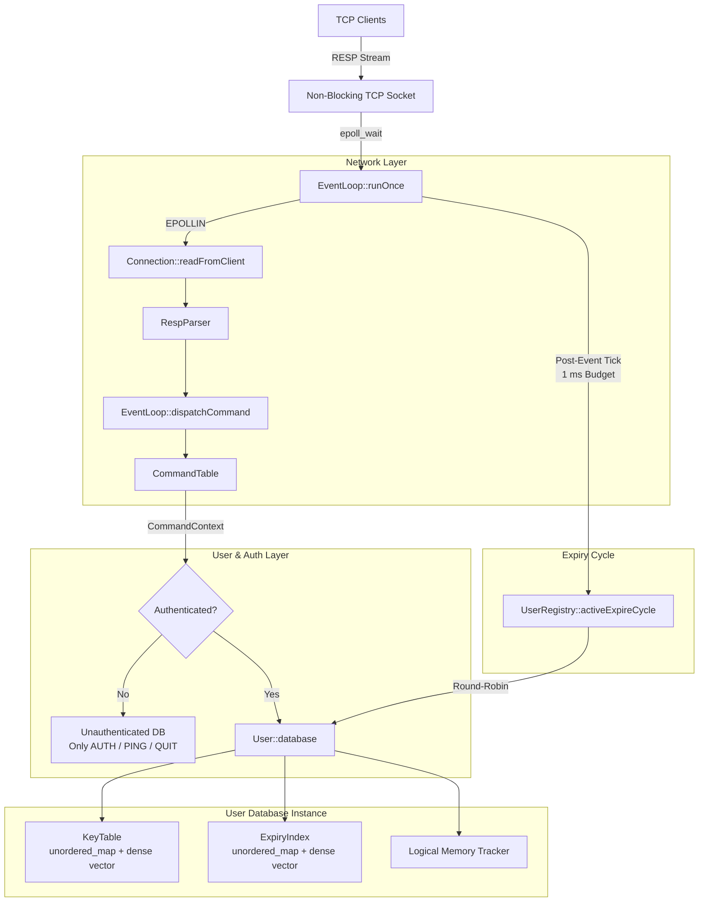
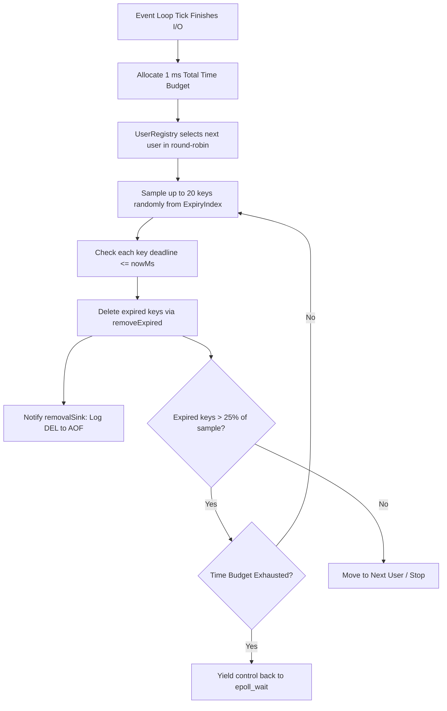
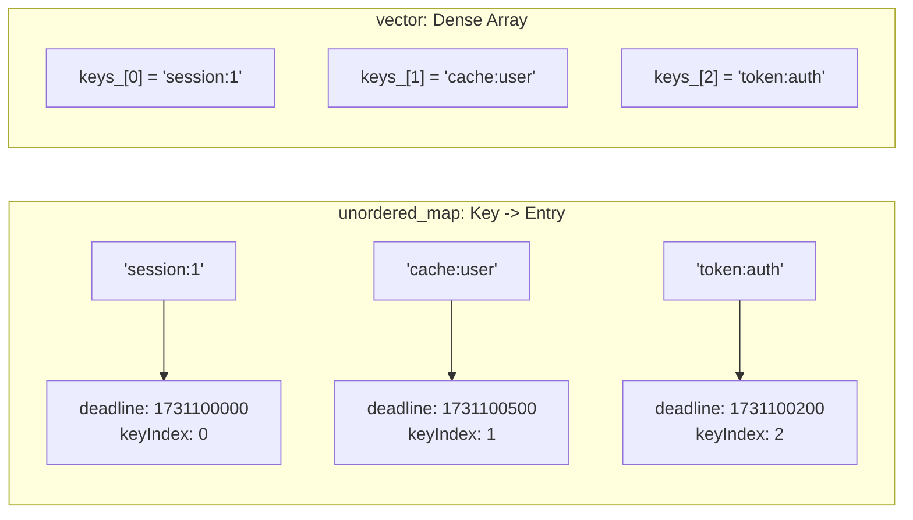

# Redis Clone: Architecture, Expiry Cycle, and Core Engine

A high-performance, single-threaded, event-driven in-memory key-value store clone of Redis written in modern C++ (C++20). The server features an `epoll`-based non-blocking network event loop, per-user database isolation, the Redis Serialization Protocol (RESP), time-bounded active and lazy key expiration, and native container data types (`String`, `Hash`, `List`, `Set`, `ZSet`).

---

## Table of Contents

1. [Architecture Overview](#architecture-overview)
2. [What Exactly is a Database?](#what-exactly-is-a-database)
   - [Per-User Isolation vs. Standard Redis DBs](#per-user-isolation-vs-standard-redis-dbs)
   - [Internal Structure of `Database`](#internal-structure-of-database)
   - [Memory Accounting (`usedBytes`)](#memory-accounting-usedbytes)
   - [The Removal Sink](#the-removal-sink)
3. [How the Server Accepts and Processes Commands](#how-the-server-accepts-and-processes-commands)
   - [End-to-End Command Lifecycle](#end-to-end-command-lifecycle)
   - [Connection Multiplexing with `epoll`](#connection-multiplexing-with-epoll)
   - [RESP Protocol Parsing](#resp-protocol-parsing)
   - [Authentication and Command Dispatch](#authentication-and-command-dispatch)
   - [Non-Blocking Reply Buffering](#non-blocking-reply-buffering)
4. [How Objects and Types (Such as Sets) Are Declared](#how-objects-and-types-such-as-sets-are-declared)
   - [The `Object` Variant Architecture](#the-object-variant-architecture)
   - [Dynamic Typing on First Write](#dynamic-typing-on-first-write)
   - [Declaring a Set: Step-by-Step Code Walkthrough (`SADD`)](#declaring-a-set-step-by-step-code-walkthrough-sadd)
   - [Type Safety and `WRONGTYPE` Enforcement](#type-safety-and-wrongtype-enforcement)
5. [The Key Expiry Cycle](#the-key-expiry-cycle)
   - [Why a Dual Expiry Strategy?](#why-a-dual-expiry-strategy)
   - [Lazy Expiry (`Database::find`)](#lazy-expiry-databasefind)
   - [Active Expiry (`Database::activeExpireCycle`)](#active-expiry-databaseactiveexpirecycle)
   - [Multi-User Round-Robin Scheduling](#multi-user-round-robin-scheduling)
   - [The Fast-Sampling Data Structure (`ExpiryIndex`)](#the-fast-sampling-data-structure-expiryindex)
   - [Freeze During Persistence Loading](#freeze-during-persistence-loading)
   - [Empirical Expiry Benchmark (1,000,000 Keys)](#empirical-expiry-benchmark-1000000-keys)
6. [Building and Running](#building-and-running)

---

## Architecture Overview



---

## What Exactly is a Database?

In standard open-source Redis, a "database" refers to numeric indices (`0` to `15`) residing inside a single shared instance. All databases share the same memory allocator, thread, and configuration, and command keys are not strictly isolated between users.

In this architecture, **a [`Database`](file:///home/lemerux/Documents/GitHub/Redis_clone/src/store/database.h#L19-L56) is an isolated, per-user state container**.

### Per-User Isolation vs. Standard Redis DBs

1. **Strict Multi-Tenancy**: Every configured user (`User`) in [`UserRegistry`](file:///home/lemerux/Documents/GitHub/Redis_clone/src/user/user_registry.h#L26-L43) owns its own private `Database` instance.
2. **Zero Cross-Talk**: Handlers receive only the authenticated client's `Database&` via [`CommandContext`](file:///home/lemerux/Documents/GitHub/Redis_clone/src/command/command.h#L13-L37). User `alice` and user `bob` can both store a key named `"session"`, modify it, or run `FLUSHALL` or `KEYS *` with zero visibility into or impact on each other's data.
3. **Session Claiming**: Each user permits one active connection session at a time (`claimSession` / `releaseSession`).

### Internal Structure of `Database`

Declared in [`src/store/database.h`](file:///home/lemerux/Documents/GitHub/Redis_clone/src/store/database.h) and implemented in [`src/store/database.cpp`](file:///home/lemerux/Documents/GitHub/Redis_clone/src/store/database.cpp), a `Database` encapsulates six core components:

```cpp
class Database {
    KeyTable keys_;            // Primary storage: string -> Object
    ExpiryIndex expiries_;     // Auxiliary TTL tracker: string -> deadlineMs
    std::size_t usedBytes_ = 0;// Running tally of logical memory
    RemovalSink removalSink_;  // Callback for external logging (AOF/eviction)
    std::mt19937_64 randomEngine_{std::random_device{}()}; // PRNG for sampling
    bool loading_ = false;     // Expiry suppression flag during replays
};
```

1. **[`KeyTable keys_`](file:///home/lemerux/Documents/GitHub/Redis_clone/src/store/key_table.h#L15-L35)**:
   - Stores key-value entries.
   - Combines a hash table `std::unordered_map<std::string, Entry>` (where `Entry` holds `Object object` and `std::size_t keyIndex`) with a dense array `std::vector<std::string> keys_`.
   - This design allows $O(1)$ key lookup and $O(1)$ random sampling (`sampleKey`) using swap-and-pop on deletion.
2. **[`ExpiryIndex expiries_`](file:///home/lemerux/Documents/GitHub/Redis_clone/src/store/expiry_index.h#L13-L30)**:
   - Tracks keys that have an explicit expiration timestamp.
   - Uses the same dual structure (hash table + dense vector) to support $O(1)$ TTL lookup, $O(1)$ update/removal, and $O(1)$ random sampling for active expiry cycles.
3. **`usedBytes_`**:
   - Maintains the precise logical memory footprint of the database without having to scan the keyspace.
4. **`removalSink_`**:
   - A function callback `std::function<void(std::string_view)>` invoked whenever a key is deleted by lazy expiry, active expiry, or memory eviction. This allows background deletions to be logged to an Append-Only File (AOF as `DEL`) without passing through the normal client command dispatcher.
5. **`loading_`**:
   - Suppresses expiration checks during snapshot (RDB) or log (AOF) recovery.

### Memory Accounting (`usedBytes`)

Every object tracks its payload size through [`Object::logicalSize(keySize)`](file:///home/lemerux/Documents/GitHub/Redis_clone/src/store/object.h#L47-L68):

$$\text{logicalSize} = \text{key.size()} + \operatorname{sizeof}(\text{Object}) + \text{dataPayloadBytes}$$

Whenever a key is inserted, replaced, or erased:
- Inserting a key adds its `logicalSize` to `usedBytes_`.
- Updating a key adjusts `usedBytes_ = usedBytes_ - oldSize + newSize`.
- Erasing a key deducts its `logicalSize`.

---

## How the Server Accepts and Processes Commands

The networking engine is fully asynchronous and single-threaded, avoiding locks, mutexes, and thread synchronization overhead.

### End-to-End Command Lifecycle

```mermaid
sequenceDiagram
    autonumber
    actor Client
    participant Kernel as Linux Kernel (epoll)
    participant Loop as EventLoop
    participant Conn as Connection
    participant Parser as RespParser
    participant Cmd as CommandTable / Handler
    participant DB as User Database

    Client->>Kernel: Connect TCP
    Kernel->>Loop: EPOLLIN on listener socket
    Loop->>Conn: accept() client, create Connection, register EPOLLIN
    Client->>Kernel: Send RESP command ("SADD myset apple banana\r\n")
    Kernel->>Loop: EPOLLIN on client socket
    Loop->>Conn: readSome() into input buffer
    Loop->>Parser: parse(connection.input)
    Parser-->>Loop: ParseResult (RespValue::Array of BulkStrings)
    Loop->>Cmd: dispatchCommand(connection, value)
    Cmd->>Cmd: Verify AUTH status & argument counts
    Cmd->>DB: Execute handler (e.g. cmd_sadd -> database.setObject)
    DB-->>Cmd: Result / modified state
    Cmd->>Conn: RespWriter::writeInt(output, 2)
    Loop->>Conn: writeSome() to client socket
    Conn-->>Client: Receive :2\r\n
```

### 1. Connection Multiplexing with `epoll`
In [`EventLoop`](file:///home/lemerux/Documents/GitHub/Redis_clone/src/net/event_loop.h#L29-L69):
- The listening socket is bound to a TCP port (default `6379`), set to `O_NONBLOCK`, and added to an `epoll` instance with `EPOLLIN`.
- `EventLoop::runOnce()` invokes `epoll_wait` with a 100 ms timeout tick (`kTimerTickMilliseconds = 100`).
- When a connection arrives, `acceptClients()` accepts the socket, configures `TCP_NODELAY` and `O_NONBLOCK`, creates a [`Connection`](file:///home/lemerux/Documents/GitHub/Redis_clone/src/net/event_loop.h#L15-L27) object, and registers the client's file descriptor in epoll with `EPOLLIN | EPOLLRDHUP`.

### 2. RESP Protocol Parsing
In [`readFromClient()`](file:///home/lemerux/Documents/GitHub/Redis_clone/src/net/event_loop.cpp#L189-L222):
- Bytes read from the socket are appended to `connection.input`.
- [`RespParser::parse()`](file:///home/lemerux/Documents/GitHub/Redis_clone/src/resp/resp.h) evaluates the buffer:
  - Returns `ParseStatus::NeedMoreData` if a complete RESP frame has not yet arrived (the event loop returns to wait for more data).
  - Returns `ParseStatus::ProtocolError` on invalid framing (the server writes an error and queues connection close).
  - Returns `ParseStatus::Ok` with a structured `RespValue` representing the command (an array of bulk strings, e.g., `["SET", "key", "val"]`).

### 3. Authentication and Command Dispatch
In [`dispatchCommand()`](file:///home/lemerux/Documents/GitHub/Redis_clone/src/net/event_loop.cpp#L242-L292):
- **Auth Enforcement**: Before a client executes `AUTH <user> <password>`, only `AUTH`, `PING`, and `QUIT` are permitted. All other commands are rejected with `-NOAUTH Authentication required.`.
- Once authenticated, `connection.authenticatedUser` points to the logged-in `User`.
- The command name is looked up in [`CommandTable`](file:///home/lemerux/Documents/GitHub/Redis_clone/src/command/command.h#L41-L46) using case-insensitive ASCII comparison.
- Argument count bounds (`minimumArguments`, `maximumArguments`) are validated.
- A [`CommandContext`](file:///home/lemerux/Documents/GitHub/Redis_clone/src/command/command.h#L13-L37) is constructed:
  ```cpp
  Database& database = connection.authenticatedUser == nullptr
                           ? unauthenticatedDatabase_
                           : connection.authenticatedUser->database;

  CommandContext context{connection.output, connection.closeAfterReply,
                         database, users_, connection.authenticatedUser,
                         connection.clientId};
  command->handler(context, *arguments);
  ```

### 4. Non-Blocking Reply Buffering
- Handlers write formatted RESP output directly into `connection.output` via [`RespWriter`](file:///home/lemerux/Documents/GitHub/Redis_clone/src/resp/resp.h).
- [`writeToClient()`](file:///home/lemerux/Documents/GitHub/Redis_clone/src/net/event_loop.cpp#L294-L318) immediately attempts to flush the output buffer using non-blocking socket writes.
- If the socket write buffer fills up (`EAGAIN` / `EWOULDBLOCK`), epoll interest is dynamically updated to include `EPOLLOUT`, ensuring remaining bytes flush as soon as the kernel socket is ready.

---

## How Objects and Types (Such as Sets) Are Declared

In Redis, keys are not declared beforehand with a schema. Instead, **types are declared dynamically on the first write command** to a given key.

### The `Object` Variant Architecture

In [`src/store/object.h`](file:///home/lemerux/Documents/GitHub/Redis_clone/src/store/object.h), an `Object` is represented using a tagged union (`std::variant`):

```cpp
enum class ObjType {
    String,
    Hash,
    List,
    Set,
    ZSet,
};

struct Hash { std::unordered_map<std::string, std::string> values; };
struct List { ListValues values; };
struct Set  { std::unordered_set<std::string> values; };

struct Object {
    using Data = std::variant<std::string, Hash, List, Set, ZSet>;

    ObjType type;
    Data data;
    std::uint32_t access_meta = 0; // For LRU / LFU eviction

    explicit Object(Set value) : type(ObjType::Set), data(std::move(value)) {}
    // Constructors for String, Hash, List, ZSet...
};
```

This design gives type safety without virtual dispatch overhead:
- No heap indirection for the `Object` wrapper itself.
- Fast, explicit inspection via `std::get_if<T>(&object->data)`.

### Dynamic Typing on First Write

When a command touches a key:
- If the key does not exist, an empty container corresponding to the command's type is created, populated, wrapped in an `Object`, and inserted into the `Database`.
- If the key exists but holds a different type, the command fails with `WRONGTYPE`.
- If the key exists and holds the matching type, the command mutates the existing container.

| Redis Type | C++ Container | Command that Declares It |
|---|---|---|
| **String** | `std::string` | `SET`, `MSET`, `INCR`, `APPEND` |
| **Hash** | `std::unordered_map<std::string, std::string>` | `HSET` |
| **List** | Ring-buffer-backed `ListValues` | `LPUSH`, `RPUSH` |
| **Set** | `std::unordered_set<std::string>` | `SADD` |
| **ZSet** | `SkipList` + `std::unordered_map<std::string_view, Node*>` | `ZADD` |

### Declaring a Set: Step-by-Step Code Walkthrough (`SADD`)

Let us trace how executing `SADD fruits apple banana` declares and stores a `Set` in [`src/command/cmd_set.cpp`](file:///home/lemerux/Documents/GitHub/Redis_clone/src/command/cmd_set.cpp#L140-L156):

```cpp
void cmd_sadd(CommandContext& context, const RespValue::Array& arguments) {
    const std::string& key = stringArgument(arguments, 1);
    
    // Step 1: Look up existing key in database (triggers lazy expiry if expired)
    const Object* existing = context.database.find(key);
    
    // Step 2: Validate existing type
    if (existing != nullptr && std::get_if<Set>(&existing->data) == nullptr) {
        writeWrongTypeError(context.output); // Returns -WRONGTYPE ...
        return;
    }

    // Step 3: Instantiate new Set{} or copy existing Set
    Set set = existing == nullptr ? Set{} : std::get<Set>(existing->data);
    
    // Step 4: Emplace elements into the unordered_set
    std::size_t added = 0;
    for (std::size_t i = 2; i < arguments.size(); ++i) {
        added += set.values.emplace(stringArgument(arguments, i)).second ? 1 : 0;
    }

    // Step 5: Store back into Database as an Object with keepTtl=true
    if (added != 0) {
        context.database.setObject(key, Object{std::move(set)}, true);
    }

    // Step 6: Reply with number of newly added elements
    RespWriter::writeInt(context.output, static_cast<std::int64_t>(added));
}
```

#### What happens inside `Database::setObject`:
```cpp
void Database::setObject(std::string key, Object object, bool keepTtl) {
    std::optional<std::int64_t> expiry;
    if (keepTtl) {
        find(key);
        expiry = expiries_.deadline(key);
    }
    if (Object* existing = find(key)) {
        const std::size_t oldSize = existing->logicalSize(key.size());
        const std::size_t newSize = object.logicalSize(key.size());
        *existing = std::move(object);
        usedBytes_ = usedBytes_ - oldSize + newSize;
        expiries_.erase(key);
        if (expiry.has_value()) {
            expiries_.set(key, *expiry);
        }
        return;
    }
    const std::size_t addedBytes = object.logicalSize(key.size());
    if (keys_.insert(key, std::move(object)) == nullptr) {
        throw std::logic_error("key insertion unexpectedly failed");
    }
    usedBytes_ += addedBytes;
    if (expiry.has_value()) {
        expiries_.set(key, *expiry);
    }
}
```
1. `Object{std::move(set)}` sets `type = ObjType::Set` and assigns the `std::unordered_set` into `data`.
2. `keys_.insert(...)` inserts the entry into `KeyTable`.
3. `usedBytes_` increments by the size of the key, `sizeof(Object)`, and the sum of lengths of all string elements inside the set.
4. If the key already had a TTL, passing `keepTtl = true` preserves the existing expiration deadline in `ExpiryIndex`.

---

## The Key Expiry Cycle

### Why a Dual Expiry Strategy?

Keys in Redis can have an optional Time-To-Live (TTL) set via commands like `EXPIRE`, `PEXPIRE`, `EXPIREAT`, or `SET ... EX`.

If a system only used **OS timers or worker threads per key**, managing millions of timers would exhaust file descriptors and kernel resources, and introducing threads would destroy single-threaded deterministic performance.

Conversely, if a system only used **Lazy Expiry** (deleting a key when someone reads it), keys that are written once and never read again would leak memory indefinitely.

Therefore, the engine employs a dual mechanism:
1. **Lazy Expiry**: Just-in-time deletion whenever any command touches a key.
2. **Active Expiry**: Periodic, probabilistic, time-bounded background sweeping.



### 1. Lazy Expiry (`Database::find`)

Every access to the keyspace routes through [`Database::find(key)`](file:///home/lemerux/Documents/GitHub/Redis_clone/src/store/database.cpp#L11-L20):

```cpp
Object* Database::find(std::string_view key) {
    if (!loading_) {
        const auto deadline = expiries_.deadline(key);
        if (deadline.has_value() && *deadline <= nowMs()) {
            removeExpired(key);
            return nullptr;
        }
    }
    return keys_.find(key);
}
```

- If `deadline <= nowMs()`, `removeExpired(key)` is triggered immediately.
- The key is removed from `KeyTable` and `ExpiryIndex`, logical bytes are deducted, and `removalSink_` is called so persistence can append a `DEL`.
- `find()` returns `nullptr`, making the key appear non-existent to the command handler.

### 2. Active Expiry (`Database::activeExpireCycle`)

At the end of every event loop pass in [`EventLoop::runOnce()`](file:///home/lemerux/Documents/GitHub/Redis_clone/src/net/event_loop.cpp#L101-L127), the active expiry cycle is executed with a strict budget of **1 millisecond** (`kActiveExpireBudget = std::chrono::milliseconds(1)`):

```cpp
users_.activeExpireCycle(kActiveExpireBudget);
```

Within a single database, the algorithm in [`Database::activeExpireCycle`](file:///home/lemerux/Documents/GitHub/Redis_clone/src/store/database.cpp#L110-L128) operates as follows:

```cpp
std::size_t Database::activeExpireCycle(std::chrono::steady_clock::duration timeBudget) {
    if (loading_ || timeBudget <= std::chrono::steady_clock::duration::zero()) {
        return 0;
    }

    const auto startedAt = std::chrono::steady_clock::now();
    const auto deadline = startedAt + timeBudget;
    std::size_t removed = 0;

    while (expiries_.size() != 0 && std::chrono::steady_clock::now() < deadline) {
        const auto [expired, sampled] = expireSample(deadline);
        removed += expired;
        
        // Probabilistic Stopping Condition:
        // If 25% or fewer of sampled keys were expired, break out.
        if (sampled == 0 || expired * 4 <= sampled) {
            break;
        }
    }
    return removed;
}
```

#### Sampling Routine (`expireSample`):
1. **Sample Batch**: Pulls up to 20 keys randomly from `ExpiryIndex`.
2. **Verify Deadlines**: Checks each sampled key against `nowMs()`. If expired, calls `removeExpired(*key)`.
3. **Adaptive Loop**:
   - If more than 25% of the sampled keys were expired (`expired * 4 > sampled`), the keyspace likely contains a high concentration of expired keys. The loop continues sampling another batch of 20 keys.
   - If 25% or fewer keys were expired, the percentage of expired keys in the keyspace is estimated to be low ($< 25\%$), and the cycle terminates early to save CPU cycles.
4. **Hard Time Boundary**: Every loop iteration checks `std::chrono::steady_clock::now() < deadline`. The cycle **never exceeds its time budget**, preventing event-loop latency spikes.

### 3. Multi-User Round-Robin Scheduling

Because databases are partitioned per user, [`UserRegistry::activeExpireCycle`](file:///home/lemerux/Documents/GitHub/Redis_clone/src/user/user_registry.cpp#L75-L94) distributes the 1 ms global budget across users fairly:

```cpp
std::size_t UserRegistry::activeExpireCycle(std::chrono::steady_clock::duration totalBudget) {
    const auto startedAt = std::chrono::steady_clock::now();
    std::size_t removed = 0;
    for (std::size_t visited = 0;
         visited < expiryUsers_.size() &&
         std::chrono::steady_clock::now() - startedAt < totalBudget;
         ++visited) {
        User* user = expiryUsers_[nextExpiryUser_];
        nextExpiryUser_ = (nextExpiryUser_ + 1) % expiryUsers_.size();
        const auto elapsed = std::chrono::steady_clock::now() - startedAt;
        removed += user->database.activeExpireCycle(totalBudget - elapsed);
    }
    return removed;
}
```
- Users are maintained in a vector `expiryUsers_`.
- `nextExpiryUser_` tracks the cursor across ticks.
- Each user is given the remaining budget slice (`totalBudget - elapsed`).
- When a user's cycle completes, the next user is evaluated on the next tick, ensuring no single user starves others.

### 4. The Fast-Sampling Data Structure (`ExpiryIndex`)

To implement active expiry efficiently, the database must sample random keys with expiration in **$O(1)$ time**.

- A **min-heap / priority queue** allows finding the earliest expiring key, but **cannot be sampled uniformly at random in $O(1)$** without walking tree nodes or popping and re-inserting elements.
- A standard **`std::unordered_map`** cannot select a random key in $O(1)$ because bucket iterators cannot be indexed randomly.

[`ExpiryIndex`](file:///home/lemerux/Documents/GitHub/Redis_clone/src/store/expiry_index.h) solves this with a **dual-structure design**:

```cpp
struct Entry {
    std::int64_t deadlineMs;
    std::size_t keyIndex; // Index into keys_ vector
};

std::unordered_map<std::string, Entry> entries_;
std::vector<std::string> keys_; // Contiguous dense array of keys
```



#### $O(1)$ Random Sampling
Generating a uniform random index takes a single array lookup:
```cpp
std::optional<std::string> ExpiryIndex::sample(std::uint64_t randomValue) const {
    if (keys_.empty()) return std::nullopt;
    return keys_[static_cast<std::size_t>(randomValue % keys_.size())];
}
```

#### $O(1)$ Swap-and-Pop Deletion
When key $K$ at `index` is erased:
1. Move the last key in `keys_` into `keys_[index]`.
2. Update the moved key's `keyIndex` in `entries_` to `index`.
3. Call `keys_.pop_back()`.
4. Erase $K$ from `entries_`.

No array shifts occur, ensuring deletions are strictly $O(1)$.

### 5. Freeze During Persistence Loading

When restoring data from RDB or replaying commands from AOF:
- `Database::setLoading(true)` is activated.
- While `loading_ == true`:
  - `Database::find()` does **not** delete expired keys.
  - `activeExpireCycle()` returns immediately without performing deletions.
- **Why?** If keys expired during server downtime, deleting them mid-replay would alter the sequence of recorded mutations (e.g., an `INCR` or `APPEND` could fail or produce wrong results if an earlier key was prematurely discarded).
- When loading completes, `Database::setLoading(false)` calls `expireAll()`, performing a single clean sweep of all keys whose deadlines passed.

---

### Empirical Expiry Benchmark (1,000,000 Keys)

The repository includes a dedicated benchmark harness [`src/benchmarks/expiry_benchmark.cpp`](file:///home/lemerux/Documents/GitHub/Redis_clone/src/benchmarks/expiry_benchmark.cpp) and execution script [`src/benchmarks/run_expiry_benchmark.sh`](file:///home/lemerux/Documents/GitHub/Redis_clone/src/benchmarks/run_expiry_benchmark.sh).

The benchmark populates **1,000,000 keys** with short TTLs and executes the event-loop active expiry cycle under a **1,000 µs (1 ms) budget**, comparing standard **`glibc`** against **`jemalloc`**:

| Allocator | Keys | Budget ($\mu$s) | Max Cycle ($\mu$s) | Populate Time | Total Expiry Time | RSS Before | RSS After | Expired Keys | Status |
|---|---|---|---|---|---|---|---|---|---|
| **glibc** | 1,000,000 | 1,000 | **1,656** | 6.16 s | 6.36 s | 3.00 GB | 3.00 GB | 1,000,000 | Over Budget (+656 $\mu$s) |
| **jemalloc** | 1,000,000 | 1,000 | **37,190** | 7.46 s | 6.82 s | 3.40 GB | **2.55 GB** | 1,000,000 | Over Budget (Decommit Spike) |

#### Analysis of Benchmark Findings:
1. **Bounded Execution Time**:
   - Under `glibc`, the maximum event-loop callback stall was **1.65 ms**, closely adhering to the configured 1.0 ms budget limit despite clearing one million entries.
2. **Memory Reclamation Behavior**:
   - `glibc` retains freed memory chunks in its internal arena heap cache, keeping RSS nearly unchanged at 3.00 GB after deallocations.
   - `jemalloc` actively decommits and purges dirty memory pages back to the operating system kernel, shrinking resident memory from **3.40 GB down to 2.55 GB** (~850 MB reclaimed).
   - The trade-off: `jemalloc`'s page purging and mutex synchronization during bulk `free()` calls within the sample pass introduces an allocator-level stall (up to ~37 ms) when massive volumes of allocations are torn down.

---

## Building and Running

### Prerequisites
- Modern C++ compiler supporting C++20 (`g++` >= 11 or `clang++` >= 13)
- CMake >= 3.16
- Linux kernel supporting `epoll`
- `jemalloc` (optional, for benchmarking)

### Build
```bash
cmake -S src -B build -DCMAKE_BUILD_TYPE=Release -DBUILD_EXPIRY_BENCHMARKS=ON
cmake --build build -j$(nproc)
```

### Run Unit Tests
```bash
ctest --test-dir build --output-on-failure
```

### Run the Redis Differential Test
The differential test starts this server and a local real Redis server on
temporary ports, then compares randomized sorted-set commands and contents.
Enable it only when `redis-server` and Python 3 are available:
```bash
cmake -S src -B build -DBUILD_REDIS_DIFFERENTIAL_TESTS=ON
cmake --build build --target redis-server container-command-test
ctest --test-dir build -R 'container-command-test|redis-differential-test' \
  --output-on-failure
```

### Run the Server
```bash
# Start listening on port 6379 (default)
./build/redis-server 6379

# Start with a users file for authentication
./build/redis-server 6379 users.conf
```

### Run Expiry Benchmark
```bash
BUILD_DIR=build ./src/benchmarks/run_expiry_benchmark.sh > expiry-benchmark.csv
```

### Run the Sorted-Set Benchmark
The benchmark defaults to 1,000,000 inserts and 1,000,000 rank queries and
reports average, p50, p95, and p99 latency in nanoseconds:
```bash
cmake -S src -B build -DCMAKE_BUILD_TYPE=Release \
  -DBUILD_ZSET_BENCHMARKS=ON
cmake --build build --target zset-benchmark --parallel
./build/zset-benchmark
```
Use `--members` and `--rank-queries` to run a smaller workload.
